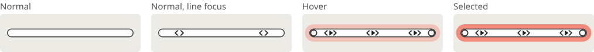
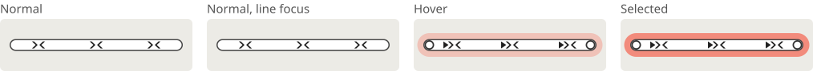
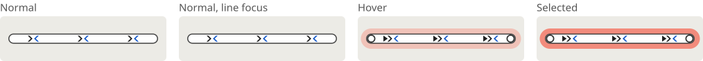
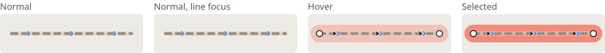
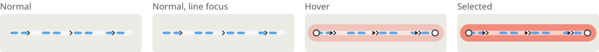
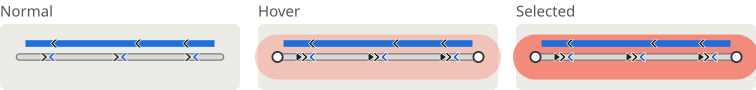
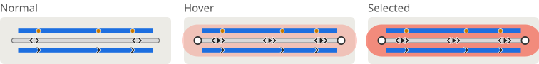
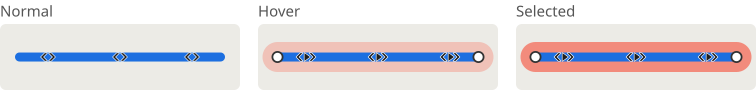
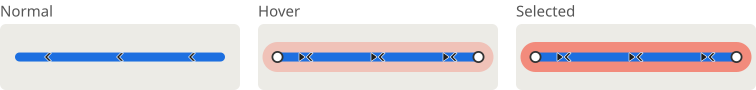

# Arrows on lines

How Maid draws which way a line may be used and which way it is drawn. Worked out with Tobias on 2026-11-26 and
2026-11-27 (the comment rounds of the design page, [research note](../research/line-arrows.md)); the decision is
[ADR 0017](../adr/0017-line-direction-glyphs.md). The sketches below are generated from the renderer's own geometry
(`bun run docs-line-arrows`), so they show what the map draws.

## Definitions

**Riding direction · chevron.** Which way traffic may use the line, as the tags say: `oneway`, `oneway:bicycle` off a
cycleway, the tags that imply a oneway (iD's list: roundabouts, motorways, rivers), and in the bicycle lens TILDA's
riding direction of a road side. One chevron: this way only. One chevron back: against the drawing direction
(`oneway=-1`). A chevron each way: both ways. Two chevrons pointing at each other (`> <`): both ways, one at a time
(`oneway=reversible`, `alternating`). This is what a map reader needs, so it is what shows at rest.

**Drawing direction · triangle.** The order of the nodes in the OSM way. It is editing information: `:left`, `:right`,
`:forward`, `:backward` and `-1` are read against it, and `-1` does not turn it (wiki, [reverse-side-keys.md](../research/reverse-side-keys.md)).
It shows on hover and selection only, combined with the chevrons into one image. A road side drawn beside its
centerline never gets it: its drawing direction is the centerline's.

**Colour · who.** Ink: all traffic. Blue: bicycles only (`oneway:bicycle` off `highway=cycleway`, or on a cycleway without `oneway`, as TILDA reads it; the bicycles' way back
on a contraflow road). Amber: the riding direction should be tagged and is not (tracks and ways of their own, bicycle
lens only). Every part is solid, on an 8 px grid, with a thin edge in the opposite tone so it reads on a road fill and on
imagery. Where iD draws its arrows white (dark lines, rail, pedestrian streets) the glyph is white with a dark edge.

**States.** Normal: chevrons on lines with a oneway (tagged or implied) and on roads whose default oneway is cancelled.
Normal in a line-focused editor (the app's `lineFocus`, Maid Bicycle): every line traffic uses shows its riding
direction, two-way ones too, every 96 px. Hover and selected: chevrons with the triangle on every open line; a line no
one travels (a fence) shows the triangle alone.

## The glyphs

At rest (left) and on hover and selection (right). The SVG files are in
[packages/renderer/assets/direction](../../packages/renderer/assets/direction/README.md).

| Glyph | At rest | Hover, selected | Tags |
| --- | --- | --- | --- |
| One way |  |  | `oneway=yes`; `junction=roundabout`; `highway=motorway`; a lane (TILDA `implicit_yes`) |
| One way, against the line |  |  | `oneway=-1` |
| Two-way |  |  | always: `junction=roundabout` + `oneway=no`; `highway=motorway` + `oneway=no` (a oneway by default, cancelled). On hover, selection and in line focus: any travelled line without a oneway, `highway=cycleway` + `oneway=no` among them |
| Reversible |  |  | `oneway=reversible`; `oneway=alternating`; `conveying=reversible` |
| One way, bicycles both ways |  |  | `oneway=yes` + `oneway:bicycle=no` |
| Same, against the line |  |  | `oneway=-1` + `oneway:bicycle=no` |
| One way for bicycles |  |  | `highway=path` + `oneway:bicycle=yes`; `highway=footway` + `oneway:bicycle=yes` |
| Same, against the line |  |  | `highway=path` + `oneway:bicycle=-1` |
| Oneway not tagged |  |  | bicycle lens: `highway=cycleway` without `oneway`; `cycleway:*=track` without `:oneway` |
| Drawing direction alone | |  | an open line no one travels (a fence) |

`oneway=-1` and `oneway:bicycle=-1` are usually lines drawn the wrong way round: Reverse (V) turns the line and makes
the tag `yes` ([ADR 0015](../adr/0015-oneway-minus-one-hook-arrows.md), addendum).

**Spacing.** All parts are 8 px high. Between two parts there are 2 px, edge to edge along the line; a triangle before a
chevron that points the same way sits in its notch, 3.6 px from it, so the white edges do not touch. Reversible `> <`
and two-way `< >` keep the same gap.

## Every case

Every way is drawn from left to right. Sketches at 1.5 times map px.

**Two-way road.** Nothing at rest in the standard style, as in iD. Line focus: the two-way glyph at rest.

**Oneway along the line** (`oneway=yes`, a roundabout, a motorway).

**Oneway against the line** (`oneway=-1`). At rest it looks like a oneway drawn the other way, as in iD; hover and
selection show "drawn this way, driven that way".

**Reversible, alternating.**

**Implied oneway cancelled** (`junction=roundabout` + `oneway=no`, `highway=motorway` + `oneway=no`): the two-way glyph,
so nobody has to know the default.

**Contraflow for bicycles** (`oneway=yes` + `oneway:bicycle=no`). `cycleway=opposite*` is lane tagging, not a property of
the centerline, and gives no glyph here.

**Footway or path, oneway**: the small size, over the thin line.

**Shared path, oneway for bicycles** (`highway=path` + `oneway=no` + `oneway:bicycle=yes`).

**Cycleway, oneway**: on a cycleway `oneway` is the cyclists' own, so the glyph is ink.

## The bicycle lens (Maid Bicycle)

The blue lines are TILDA's parts: the way and its road sides. The road sides carry the rest glyphs as line patterns,
small, and never get the triangle. The way itself shows the renderer's glyphs, like any line in a line-focused editor;
the renderer marks an untagged cycleway or path amber itself (`needsRidingTag`).

**Two-way road with bike lanes** (`cycleway:both=lane`): the left lane rides against the line, the default of
`cycleway:left:oneway` (`-1`), assumed and not mapped.

**Oneway road with a contraflow lane** (`oneway=yes` + `oneway:bicycle=no` + `cycleway:left=lane` +
`cycleway:left:oneway=-1`).

**Tracks, one without its oneway** (`cycleway:right=track` + `cycleway:right:oneway=yes` + `cycleway:left=track`): a
track should say how it is ridden; TILDA's guess is not drawn as a fact.

**Cycleway of its own**: two-way when tagged (`oneway=no`), not tagged (no `oneway`), against the line (`oneway=-1`).

| Part | TILDA `oneway` | Glyph |
| --- | --- | --- |
| Lane (road side) | `yes`, `implicit_yes` | with or against, by `_lineReversed` |
| Any part | `no`, `car_not_bike` | two-way |
| Bicycle road, crossing, link (the way) | `assumed_no`, `implicit_yes` | two-way |
| Track, way of its own | `yes` | with or against |
| Track, way of its own | `implicit_yes`, `assumed_no` | not tagged (amber) |

The fields say the same: the oneway field shows "Assumed to be Yes" for an implied oneway, and the TILDA checklist shows
an untagged lane or track oneway as not tagged with its default, and a way's own as a guess.

## How the style does it

- `build.ts` gives each line `ow` (the glyph kind, `ridingOf`), `tr` (traffic uses it), `mo` (a way of its own that
  should tag its riding direction and does not, `needsRidingTag`), `lt` (light glyph) and, under a dimming lens, `ao`
  (the glyph's opacity).
- Two pairs of symbol layers on the lines: `line-oneway` and `line-oneway-active` for lines with `ow`, every 48 px;
  `line-two-way` and `line-two-way-active` for all other lines, every 96 px (two-way where traffic uses it, `missing`
  for `mo` in a line-focused editor, the triangle alone elsewhere). The rest layer of the second pair shows only in a
  line-focused editor.
- Each pair draws the same lines with the same spacing and image size, so the rest and the active glyph sit on the same
  anchors. Feature state (`hover`, `selected`) fades one into the other: hover and selection move nothing.
- One more pair puts a glyph in the middle of every line, drawn whatever is there, so a short line shows its direction
  too. It is drawn from one point per way (`line-centre.ts`, the middle by length with the line's angle there), not with
  `symbol-placement: line-center`, which works per tile piece and could draw two glyphs on a line across a tile border.
  The rest glyph is placed first and the spaced glyphs keep clear of it; the active one takes no room, so an invisible
  glyph never pushes another line's glyph away.
- Size follows the line: inside the road fill (the fill minus 2 px), 5.2 px over a thinner line.
- The bicycle lens draws only the road sides' riding direction, as `line-pattern` images
  `maid-line-glyph-<with|against|both|missing>` (`features.ts` `ridingDirection`); the way itself shows the renderer's
  glyphs.
- Images are drawn in code from `glyph.ts` (`direction-images.ts`); one image per kind, state and tone, built ahead.
