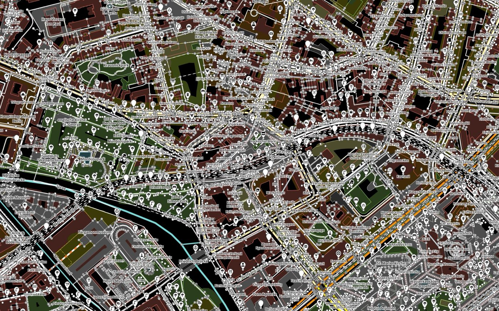
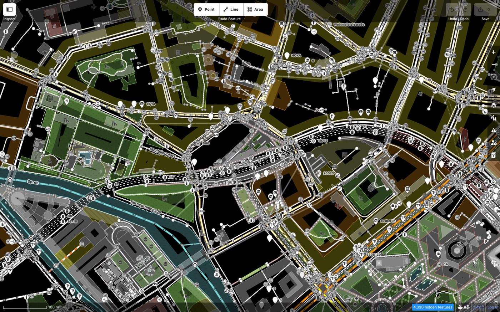
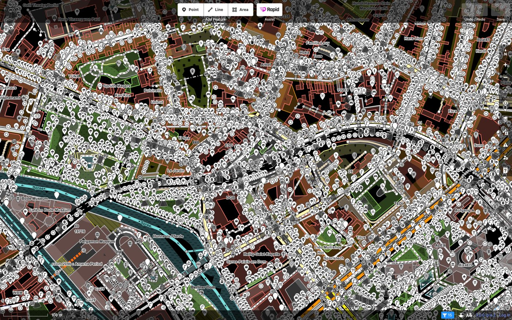
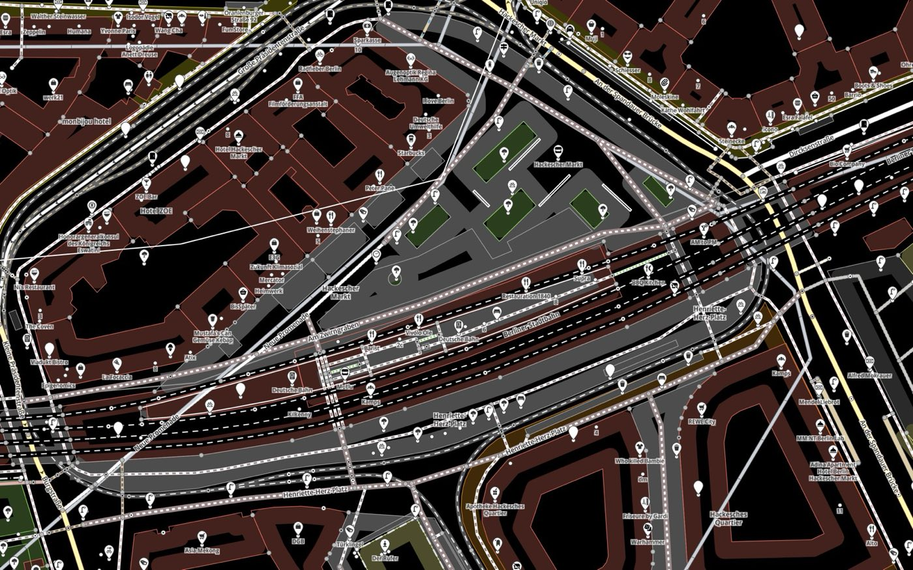
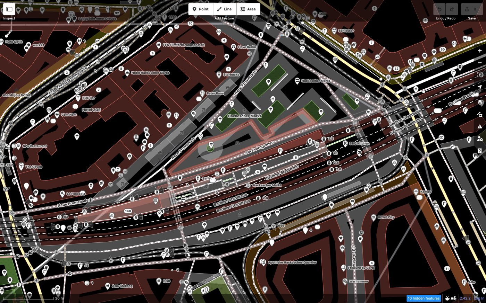
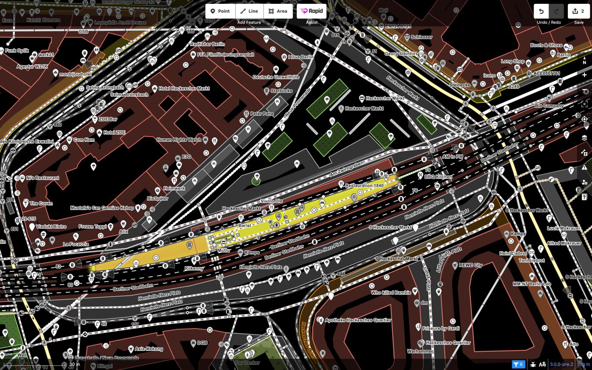
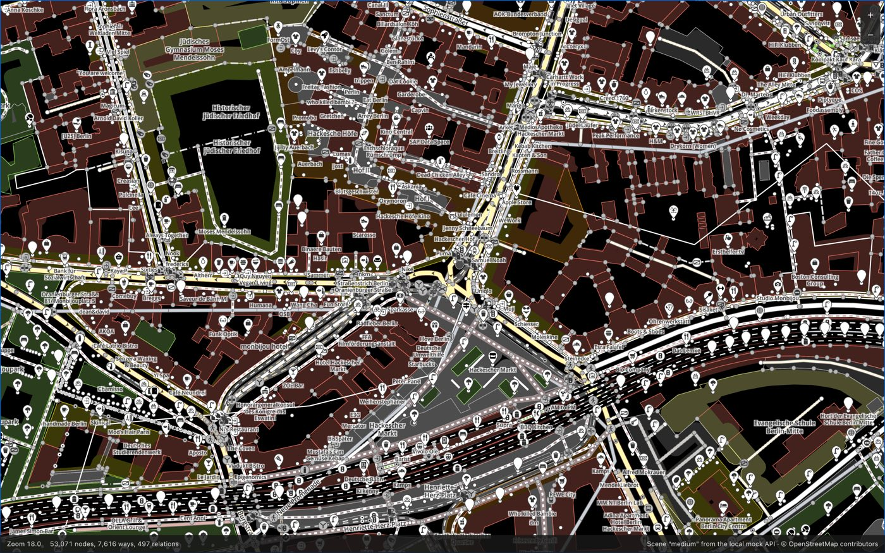

# Iteration 1: can Maid render OSM data with MapLibre?

Third edition, 2026-10-11. The first edition compared Maid with iD and Rapid as they ship. The second switched off validation in iD and Rapid so that all three only render, added a vertex drag with the real mouse, and added Firefox and WebKit. This one adds the speed work on Maid's weak spot and re-runs the full comparison.

Run on one machine (Apple M4, Chrome 154 headless with GPU, 1600×1000 at 2x). Full tables and all screenshots: `reports/2026-10-10-21-58-final2/report.html` (generated, not in git).

## Answer

**Yes, this is a feasible path.** With validation off in iD and Rapid, Maid holds 60 frames per second in every scenario, including dragging a vertex. iD drops to 7 to 31 and Rapid to 30 to 42 when panning or hovering on the larger scenes. Maid loads every scene fastest and uses the least memory.

What you should weigh:

1. **One scenario is still behind: the final picture after zooming out on the dense scene.** Maid needs 1.1 s, iD 0.8 s, Rapid 0.3 s. On the medium scene Maid is now level with iD (0.7 s against 0.8 s). The map stays smooth during that time. This was 2.3 s before tonight's work; what helped and what is left is in "The weak spot and what was done".
2. **Rapid is as smooth as Maid when dragging a vertex** (59 fps). Maid's advantage over Rapid is in loading, panning, hovering and memory. Its advantage over iD is everywhere except the latency of a single hover.
3. **Maid is still not a full editor.** It has an inspector, tag editing and vertex dragging, but no undo, no saving, no presets form, no relations editing.
4. **The thresholds from the plan were never confirmed.** Checked against them, one is not met and one is met on one scene only (below).

## Look

The same view of the medium scene (Mitte, Hackescher Markt) after loading. Same camera, same data, no background.

| Maid (MapLibre) | iD 2.42.2 (SVG) | Rapid 3 (PixiJS) |
| --- | --- | --- |
|  |  |  |

Two levels closer:

| Maid | iD | Rapid |
| --- | --- | --- |
|  |  |  |

What the pictures show:

- **Lines and areas match iD.** Colours, widths, casings, dashes and the low-zoom widths are not copied by hand: Maid generates them from iD's own stylesheets (713 rules) and presets. See [ADR 0001](../adr/0001-style-from-id-css.md).
- **iD shows much less by default.** In the medium scene it hides 622 buildings, 3274 points and 417 address points ("4,328 hidden features"), because it cannot draw them fast enough. Maid and Rapid draw them. With hiding switched off iD looks like this: [medium-load-id-no-auto-hide.jpg](img/medium-load-id-no-auto-hide.jpg).
- **Points need a density rule in any editor.** Rapid draws every pin and the map disappears under them. Maid draws every point as a dot and adds pins where they fit ([ADR 0004](../adr/0004-points-as-dots-plus-pins-that-fit.md)). That is a design choice of mine, not iD's look.

Core subset, item by item:

| Item | State in Maid | Gap |
| --- | --- | --- |
| Roads: casing, stroke, zoom bands | Comparable | Stacking uses three bands (below, ground, above), iD has one per `layer` value |
| Paths, tracks, dashes | Comparable | |
| Bridges and tunnels | Comparable in colour and dash | Same stacking limit |
| Buildings, landuse, water: outline | Comparable | |
| Partial fill (iD's default) | Close | Built as an inward-offset line whose width is capped by the area's size. It cannot be clipped to the area, so very irregular shapes get an uneven band |
| Points with preset icons | Comparable where a pin is shown | Density rule differs on purpose. Preset matching is simplified |
| Vertices | Comparable | Dots for tagged, shared and end vertices; tagged vertices with a preset show the disc with its icon from zoom 17 on. Not compared one by one with iD |
| Labels | Present | Many more labels than iD (every named point). Placement differs. Fonts for Cyrillic and other scripts are missing |
| Oneway arrows | Present | Not compared in detail |
| Hover and select halo | Comparable | A selected way shows its shape points. No midpoints |
| Not built | | Fill patterns, sided markers (cliffs, kerbs), turn restrictions, midpoints, wireframe mode |

None of the gaps looks like something MapLibre cannot do, with one exception to watch: iD interleaves casing and stroke per `layer` value, which costs MapLibre one layer group per value.

## Speed

Medians of three runs, validation off in iD and Rapid. Lower is better unless noted. Bold marks the best of the three. Ranges are in the generated report; in this run they were narrow.

### Loading: from opening the page until the picture is complete (ms)

| Scene | Maid | iD | Rapid |
| --- | ---: | ---: | ---: |
| small (11k nodes loaded) | **579** | 1318 | 1595 |
| medium (39k) | **1558** | 2077 | 3223 |
| dense (51k) | **2222** | 2672 | 3880 |

iD draws less than the other two: it hides buildings and points on the larger scenes. Rapid loads a larger area around the view.

### Panning with a real mouse drag

| | Maid | iD | Rapid |
| --- | ---: | ---: | ---: |
| Frames per second over loaded data, medium | **59.6** | 30.7 | 37.1 |
| Frames per second over loaded data, dense | **59.6** | 22.8 | 34.2 |
| Worst frame, medium (ms) | **17** | 383 | 50 |
| Worst frame, dense (ms) | **17** | 867 | 67 |
| Into new data: worst frame, dense (ms) | **17** | 633 | 50 |
| Into new data: until the picture is final, medium (ms) | **123** | 1522 | 624 |
| Into new data: until the picture is final, dense (ms) | **16** | 1638 | 41 |

iD and Rapid move a stale picture while you drag and redraw it now and then; iD's long frames are those redraws. Maid redraws the real data on every frame.

### Zooming with the mouse wheel, two levels in and back

| | Maid | iD | Rapid |
| --- | ---: | ---: | ---: |
| Worst frame zooming in, medium (ms) | **17** | 400 | 50 |
| Worst frame zooming in, dense (ms) | **33** | 1100 | 317 |
| Until final after zooming in, medium (ms) | 324 | 879 | **251** |
| Until final after zooming out, medium (ms) | 713 | 788 | **144** |
| Until final after zooming out, dense (ms) | 1146 | 822 | **305** |

Zooming out is the one place where Maid is not ahead of iD on the dense scene. The wheel overshoots, the view grows, and new OSM tiles are fetched around it.

### Hover and select

| | Maid | iD | Rapid |
| --- | ---: | ---: | ---: |
| Pointer move to highlight, medium (ms) | 14.0 | **3.6** | 38.6 |
| Pointer move to highlight, dense (ms) | **10.1** | 26.6 | 50.2 |
| Frames per second while sweeping the pointer, medium | **59.5** | 14.1 | 41.6 |
| Frames per second while sweeping, dense | **59.4** | 6.7 | 30.0 |
| Select a way until drawn, medium (ms) | **31** | 359 | 65 |
| Select a way until drawn, dense (ms) | **31** | 431 | 81 |

Maid's select includes opening its inspector.

### Dragging a vertex with the real mouse

A road junction is pressed and moved in a small circle for two seconds, one zoom level closer than the other scenarios. The benchmark checks that the node really moved in each editor's data.

| | Maid | iD | Rapid |
| --- | ---: | ---: | ---: |
| Frames per second, medium | **60** | 20 | 59 |
| Frames per second, dense | **60** | 8.5 | 59 |
| Worst frame, medium (ms) | **17** | 150 | **17** |
| Worst frame, dense (ms) | **17** | 333 | **17** |
| Until final after release, medium (ms) | 110 | **0** | 33 |
| Until final after release, dense (ms) | **10** | **10** | 27 |

Maid and Rapid are equally smooth; iD is not.



### Memory after a run (JS heap, MB)

| Scene | Maid | iD | Rapid |
| --- | ---: | ---: | ---: |
| medium | **67** | 126 | 361 |
| dense | **66** | 163 | 473 |

GPU memory is not included; it cannot be read this way.

### Firefox and WebKit

Playwright's builds of Firefox 155 and WebKit 26.6, medium scene, two runs each. These runs are from before the live tier (see below); they were not repeated. Main-thread work and heap cannot be measured there.

| | Maid | iD | Rapid |
| --- | ---: | ---: | ---: |
| Firefox: frames per second while panning | **59.6** | 9.2 | 12.6 |
| Firefox: frames per second while dragging a vertex | **60** | 8 | 30 |
| Firefox: load until complete (ms) | **2237** | 2944 | 5012 |
| WebKit: frames per second while panning | **59.2** | 14.8 | did not run |
| WebKit: frames per second while dragging a vertex | **59** | 4.5 | did not run |
| WebKit: load until complete (ms) | 2942 | **2698** | did not run |

Maid behaves the same in all three browsers. iD and Rapid are slower in Firefox than in Chrome. Rapid did not get past loading in Playwright's WebKit ("pattern textures not loaded"); that may be this WebKit build or our host page, and says nothing certain about Safari.

### Does validation explain iD's and Rapid's numbers?

No. Switching it off changed little: on the dense scene iD panned at 21.6 fps with it and 22.8 without, Rapid at 30.3 and 34.2. Their frame rates are set by drawing.

## Against the thresholds from the plan

| Threshold (proposed, never confirmed) | Result |
| --- | --- |
| Look: every core item comparable or with a documented gap | Met. Gaps are listed above; none is a known dead end |
| Better than iD on every scenario in medium and dense: load | Met |
| ... settle time after a camera move | Met on medium. **Not met after zooming out on dense**: 1146 ms against 822 ms. Met in the other camera scenarios, counting iD's redraw at the end of a gesture |
| ... hover latency | Met on dense (10 against 27 ms). Not met on medium (14 against 3.6 ms); both are within one frame |
| p95 frame time within 1.25 times Rapid's on dense | Met. Maid 16.8 ms, Rapid 50 to 67 ms |
| Settle time not worse than Rapid's | **Not met after zooming** (0.3 to 1.1 s against 0.15 to 0.3 s). Met when panning into new data |
| A changed node on screen within 50 ms | Met: 60 fps during a real drag on every scene |

## The weak spot and what was done

After the second edition, Maid's one consistent weakness was the wait for the final picture when new data arrives. A trace showed why: each of the four sources got an update, and MapLibre re-tiled the **whole** source and rebuilt every visible tile, although only a strip at the edge was new. iD and Rapid only draw what is new.

Three changes, each with a decision record:

| Change | Effect on the dense scene |
| --- | --- |
| Four MapLibre workers instead of the default one ([ADR 0007](../adr/0007-workers-and-batched-updates.md)) | Final picture after panning into new data: about 0.8 s instead of 1.5 s |
| A small live tier for new and changed data, merged into the big sources when idle ([ADR 0008](../adr/0008-live-tier-for-new-and-changed-data.md)) | About 0.4 s in the focused test; 16 ms in the full run, where less new data comes in |
| MapLibre's fixed 200 ms after a wheel zoom, patched to 40 ms ([ADR 0006](../adr/0006-wheel-zoom-finish-delay.md)) | Camera at rest 240 ms after the last wheel event instead of 400 ms |

Across the three full runs of this night, Maid's medians on the dense scene moved like this:

| | Before | Four workers | Plus live tier |
| --- | ---: | ---: | ---: |
| Load until complete (ms) | 2875 | 2019 | 2222 |
| Pan into new data: until final (ms) | 638 | 330 | 16 |
| Pan over loaded data: until final (ms) | 772 | 386 | 97 |
| Zoom out: until final (ms) | 3619 | 2291 | 1146 |
| After releasing a dragged vertex (ms) | 355 | 281 | 10 |

What is left: zooming out on the dense scene. The view grows, a ring of new tiles arrives, and the live tier then holds a lot of data at a zoom level where many features are in view. Ideas, none tried: fetch the ring before the zoom finishes, a lower-detail drawing while the wheel turns, a shorter label fade.

## What I explored and changed along the way

Each of these was measured; the numbers are in the decision records.

| Finding | Effect |
| --- | --- |
| Diff updates instead of re-sending everything | Pan into new data on dense: final after 0.5 s instead of 1.7 s |
| One update per source at a time | Works around a MapLibre 6.12 problem: overlapping `updateData` calls left tiles inconsistent and made feature queries throw. Needs an upstream report |
| Pins as symbols on every point | Was the most expensive part of the style. Dots plus fitting pins fixed readability and cost |
| Label fade at 0 ms | Makes MapLibre place all symbols on every frame: 990 ms of work per second while panning. 150 ms is the default now |
| Hover through feature state instead of a highlight source | Highlight after 7 ms instead of 23 ms |
| Edit source for changing features | 17 ms instead of 166 to 600 ms per change |
| Markers created before their features arrive | Images added later did not appear in tiles that were already laid out |
| Four MapLibre workers instead of one | Final picture after panning into new data about twice as fast |
| A live tier for new and changed data | Halved it again; nothing is written back when a dragged vertex is released |
| MapLibre's fixed 200 ms after a wheel zoom, patched to 40 ms | Camera at rest 240 ms after the last wheel event instead of 400 ms |
| Validation off in iD and Rapid | Changed their numbers little |
| Source zoom limit 15 to 19, pins and labels off | No effect on the wait after a zoom |

### Where the wait after a zoom comes from

Measured separately on the dense scene, jumping two zoom levels in and back five times and timing until Maid reports the final picture (`bun tools/bench/zoom-settle.ts`):

| Setting | Zoom in | Zoom out |
| --- | ---: | ---: |
| Default (tiles cut up to MapLibre zoom 17) | 340 ms (181 to 371) | 215 ms (201 to 218) |
| Tiles cut up to zoom 19, 16 or 15 | 184 to 199 ms | 215 to 248 ms |
| Without pins and labels | 183 ms | 200 ms |
| Label fade off (`fade=0`) | **11 ms** (10 to 104) | **24 ms** (18 to 48) |

So the zoom limit of the sources does not matter, and neither do pins and labels as such. About 150 ms of every wait is the label fade, which Maid counts because MapLibre only reports "idle" when it is over. Tiles of a zoom level that was visited before are ready within a frame or two.

This table is from before the wheel-zoom patch. A second script (`bun tools/bench/wheel-zoom.ts`) later split the wait after a real wheel zoom: 200 ms of camera easing, then a fixed 200 ms in which MapLibre still counts the map as zooming, then the fade. The fixed part is now patched down to 40 ms. The fade stays: turning it off makes MapLibre place symbols on every frame, which cost 990 ms of main-thread work per second in an earlier measurement.

## How far to trust the numbers

- **Unequal work, less than before.** iD and Rapid now run without validation. They still carry a full UI, undo history and presets; Maid has an inspector with tag editing and nothing else.
- **One machine, a fast one.** Apple M4 with GPU. Slower machines and integrated graphics were not tested. That matters most for Maid, because MapLibre leans on the GPU and on worker threads.
- **Headless browsers.** Chrome for the main run, Playwright's Firefox and WebKit for a smaller one. No real Safari, no touch devices.
- **Background load.** During the second edition's runs another application used a full core. The final run was quieter and its ranges are narrow. The focused five-run comparisons in the decision records were made under load.
- **Frame rate is capped at 60.** Maid sits at the cap in every scenario, so the tables do not show how much headroom it has. Main-thread work per second is the better hint: 180 to 350 ms out of 1000.
- **"Final picture" is defined per editor.** The definitions are in `tools/refs/id/NOTES.md`, `tools/refs/rapid/NOTES.md` and `packages/renderer/src/engine.ts`. Maid's includes the label fade; iD's redraw at the end of a drag happens inside the gesture and shows up as a long frame, not as settle time.
- **Three repeats** for the main run, two for Firefox and WebKit, five for the worker and batching comparison, one for most other configuration comparisons. One iD run of an earlier full run did not finish in five minutes; the final run had no failures.
- **iD without hiding** (drawing everything) was only measured in the first edition: about 3 fps while panning the larger scenes.
- **Both reference editors ran without the name-suggestion-index** and without background imagery, with the sidebar collapsed.
- **Not examined:** geometry precision at very high zoom (OSM zoom 22 and above, where MapLibre overzooms tiles), relations beyond simple multipolygons, scenes larger than about 60k loaded nodes, low zoom levels.

No request left the machine in any run. Every non-localhost request is blocked and counted, and the count was zero for all three editors.

## What I recommend

Go ahead with MapLibre. Next, in this order:

1. **Real editing with undo.** Port iD's graph and history as the data layer ([extensibility plan](../extensibility-plan.md)); the current store cannot undo. The live tier is ready to carry it.
2. **Tests for the live tier.** It is the most intricate part of the renderer and has one manual consistency check.
3. **Zooming out on dense data**, with the ideas above.
4. **Send the MapLibre report** ([draft](../upstream/maplibre-updatedata-inconsistent-tiles.md)) once you have read it. Nothing has been posted.

## Reproduce

```bash
bun install
bun run refs-setup      # clones and builds iD and Rapid at their pins
bun run bench --repeat 3 --label final2
bun run bench --browser firefox --scene medium --repeat 2 --label firefox
bun run bench --editor id --repeat 2 --label id-cull0 --variant "no auto-hide" --id-query "cull=0"   # iD drawing everything
bun run bench-report <run-id> [<run-id> ...]
bun run compare         # the three editors side by side on http://localhost:5184
```
